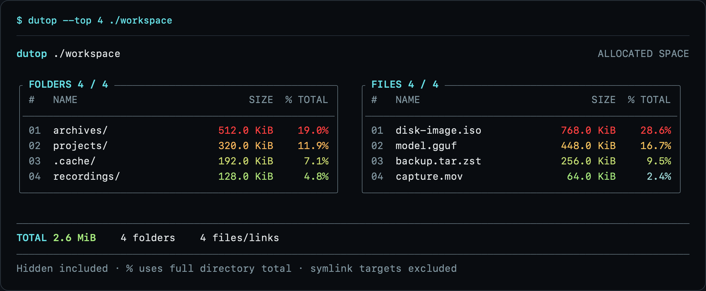

<div align="center">

<h1>📊 dutop</h1>

<p><strong>Big folders. Big files. One clear view.</strong></p>

<p>Find your directory's biggest space hogs without losing the bigger picture.<br>
Two ranked panels. A complete total. Back to your shell.</p>

<p>
  <a href="Cargo.toml"></a>
  <a href="https://github.com/JuanFontes/homebrew-tap"></a>
  <a href="#platform-support"></a>
  <a href="#install"></a>
</p>

<p>
  <a href="https://github.com/JuanFontes/dutop/actions/workflows/ci.yml?query=branch%3Amain"></a>
  <a href="https://github.com/JuanFontes/dutop/releases/latest"></a>
  <a href="#usage"></a>
  <a href="LICENSE"></a>
</p>

<p>
  <a href="#quick-start">🚀 Quick start</a> ·
  <a href="#preview">👀 Preview</a> ·
  <a href="https://github.com/JuanFontes/dutop/releases/latest">📦 Downloads</a> ·
  <a href="#how-sizes-work">📏 Size accounting</a> ·
  <a href="CONTRIBUTING.md">🤝 Contributing</a>
</p>

</div>

## 📊 What is dutop?

`dutop` scans a directory and turns its disk usage into two ranked panels:
**folders on the left, files on the right**, with the full directory total below.
Pick your top count, spot the heavy hitters, and get back to your shell.

Run it inside a project, a downloads folder, or a backup directory. It measures
folders recursively but lists only immediate entries, so the result stays useful
at the level where you are working.

**The CLI is written in Rust.** Installed packages run without Python, an external
`du` process, or a Rust toolchain. It prints a report and exits: scanning is
read-only, and `Ctrl+C` cancels it. No background service is started.

> **Native packages.** Available for macOS and Linux on ARM64 and x86_64.
> See the [platform matrix](#platform-support) for tested systems and compatibility limits.

<a id="features"></a>

## ✨ Features at a glance

| Feature | What you get |
| --- | --- |
| 🗂️ **Two independent rankings** | The largest immediate folders and files, side by side. |
| 🧮 **A complete total** | Every scanned entry contributes, including hidden paths and items outside the top list. |
| 🎚️ **Your top count** | Choose **1–99 entries per panel**; the default is 10. |
| 🌡️ **Relative heat colors** | Larger entries transition from yellow to strong red; small ones keep their original colors. |
| ↔️ **Responsive panels** | Narrow terminals stack the panels; long names preserve their endings, extensions and link markers when space permits. |
| 🦀 **Native allocation scanning** | Reads filesystem metadata, not file contents, to measure allocated disk space. |
| 📦 **Ready-to-run packages** | Homebrew, native archives, and Debian packages with SHA256 checksums and license notices. |
| 🚦 **Explicit partial results** | Unreadable paths produce a marked partial total and a nonzero exit code. |

**Jump to:** [Quick start](#quick-start) · [Examples](#usage) · [Read the report](#read-the-report) · [Install](#install) · [Size accounting](#how-sizes-work) · [Documentation](#documentation)

<a id="quick-start"></a>

## 🚀 Quick start

**Homebrew** on macOS or Linux, ARM64 or x86_64:

```sh
brew install juanfontes/tap/dutop
dutop --top 4 ~/Downloads
```

Homebrew adds the tap automatically and installs a verified native archive.
Refresh the catalog with `brew update`, then update with `brew upgrade dutop`.
Remove it with `brew uninstall dutop`.

Already installed a manual copy? Run `type -a dutop` to see whether an older
executable appears before Homebrew in your `PATH`.

**Choose how much to see:** `dutop` shows the top 10 by default. Use `--top 4`
for a compact report or `--top 99` to see more. The complete total stays the same.

<a id="preview"></a>

## 👀 See the space hogs

```sh
dutop --top 4
```



Rendered from actual `dutop 0.1.0` output on macOS using a sample directory.
Only the path is shortened. Allocations can differ by filesystem.

<details>
<summary>Text-only version of the example</summary>

```text
dutop ./workspace                                                                              ALLOCATED SPACE

╭ FOLDERS 4 / 4 ────────────────────────────────────╮   ╭ FILES 4 / 4 ──────────────────────────────────────╮
│ #   NAME                            SIZE  % TOTAL │   │ #   NAME                            SIZE  % TOTAL │
│───────────────────────────────────────────────────│   │───────────────────────────────────────────────────│
│ 01  archives/                  512.0 KiB    19.0% │   │ 01  disk-image.iso             768.0 KiB    28.6% │
│ 02  projects/                  320.0 KiB    11.9% │   │ 02  model.gguf                 448.0 KiB    16.7% │
│ 03  .cache/                    192.0 KiB     7.1% │   │ 03  backup.tar.zst             256.0 KiB     9.5% │
│ 04  recordings/                128.0 KiB     4.8% │   │ 04  capture.mov                 64.0 KiB     2.4% │
╰───────────────────────────────────────────────────╯   ╰───────────────────────────────────────────────────╯

──────────────────────────────────────────────────────────────────────────────────────────────────────────────
TOTAL 2.6 MiB    4 folders    4 files/links
──────────────────────────────────────────────────────────────────────────────────────────────────────────────
Hidden included · % uses full directory total · symlink targets excluded
```

</details>

<a id="usage"></a>

## 🧰 Everyday usage

```text
dutop [OPTIONS] [DIRECTORY]
```

| Option | What it does |
| --- | --- |
| `DIRECTORY` | Directory to scan; defaults to the current directory. |
| `-n, --top <N>` | Entries per panel, from **1 to 99**; defaults to **10**. |
| `-h, --help` | Show usage, examples and size-accounting details. |
| `-V, --version` | Print the installed version. |

```sh
dutop                              # Top 10 folders and files here
dutop ~/Downloads                  # Inspect another directory
dutop --top 4                      # A shorter report
dutop -n 20 ./projects              # More detail, same complete total
dutop --top=99 "/path/with spaces"  # Up to 99 entries in each panel
NO_COLOR=1 dutop                    # Keep the layout, disable colors
dutop > disk-usage.txt              # Save a plain-text report
```

The count applies **independently to each panel**. `--top 4` can show four folders
and four files. It changes how many entries are displayed, not how much is scanned.

<a id="read-the-report"></a>

### 📖 Read the report

| Field | Meaning |
| --- | --- |
| `FOLDERS 4 / 61` | Four folders shown out of 61 immediate folders found. |
| `FILES 4 / 282` | Four non-directory entries shown out of 282 found, including links. |
| `SIZE` | Allocated disk space for the entry; folders include their descendants. |
| `% TOTAL` | Entry size divided by the complete scanned directory total. |
| `[LINK]` | A symbolic link; its target is excluded from the scan. |
| `TOTAL` | The complete scan total, including entries outside the displayed rankings. |

With `--top` above 3, **size and percentage colors are relative to the largest
entry in each panel**. The largest is strong red, intermediate values transition
through yellow, and entries at or below 20% of that panel's maximum keep the
original green size and cyan percentage. `--top 1`, `2` and `3` use the original
colors throughout.

The color scale and the printed percentage serve different purposes: colors help
compare entries within a panel; percentages show their share of the full directory.
Changing `--top` from 10 to 99 does not change an entry's color or percentage for
the same scan results.

Colors are disabled when stdout is piped, when `NO_COLOR` is set, or when
`TERM=dumb`. Narrow layouts prioritize names and sizes as space runs out.

<a id="install"></a>

## 📦 More ways to install

**[Download native archives, Debian packages, and SHA256SUMS →](https://github.com/JuanFontes/dutop/releases/latest)**

Prefer Homebrew? The [quick start](#quick-start) covers installation, upgrades and removal.

### Debian / Ubuntu

Download the `.deb` for your architecture from
[Releases](https://github.com/JuanFontes/dutop/releases/latest): `amd64` for Intel/AMD,
`arm64` for ARM. Verify it against the release's `SHA256SUMS`, then install:

```sh
sudo apt install ./dutop_0.1.0_amd64.deb
dutop --help
```

Use the `arm64` filename on ARM. Remove the package with `sudo apt remove dutop`.
No additional package repository is configured.

### Native archives

Each release also has `.tar.gz` archives for all four platforms. Download the
matching archive and `SHA256SUMS`, verify the selected file, then extract it.
For example, on an Apple Silicon Mac:

```sh
shasum -a 256 dutop-0.1.0-aarch64-apple-darwin.tar.gz
# Compare the result with its line in SHA256SUMS before extracting.
tar -xzf dutop-0.1.0-aarch64-apple-darwin.tar.gz
./dutop-0.1.0-aarch64-apple-darwin/dutop --help
```

Keep the accompanying license notices when redistributing a binary.

### Build from source

You need Rust and Cargo on macOS or Linux. From a checkout of this repository
containing `Cargo.toml`, install the executable with:

```sh
cargo install --locked --path .
dutop --help
```

Cargo normally installs into `~/.cargo/bin`; make sure that directory is in your
`PATH`. Rust is needed to build the executable, not to run it afterward.

To try a release build directly from the checkout:

```sh
cargo build --release --locked
./target/release/dutop --top 4 ~/Downloads
```

<a id="platform-support"></a>

## 💻 Platform support

| Platform | CPU | Package baseline | Native CI |
| --- | --- | --- | --- |
| macOS | Apple Silicon / Intel | macOS 13+ | macOS 15 |
| Linux | ARM64 / Intel & AMD x86_64 | Static musl executable | Ubuntu 24.04 |

Older macOS versions are deployment targets, not separate tested runners. Static
Linux binaries avoid a glibc dependency; filesystem and kernel compatibility still
matter. Windows is not implemented. See [release details](docs/releasing.md).

<a id="how-sizes-work"></a>

## 📏 How sizes work

`dutop` reports **allocated disk space**, using binary units such as KiB, MiB and
GiB. This is the storage allocation reported by the filesystem, rather than a
file's logical length. A sparse file can therefore be much larger logically than
the allocation shown here.

- **Immediate entries are listed; folders are measured recursively.** Scanning
  `/projects` shows `/projects/app`, with its descendants included in that row.
- **Hidden entries and mounted filesystems are included.** A small `--top` value
  does not make a large directory tree cheaper to scan.
- **Child symlinks are not followed.** A symlink explicitly supplied as the root
  directory can resolve to its target.
- **Hard-linked data counts once in the total.** File rows can each show the same
  allocation, while folder totals attribute shared data to the first entry reached
  in deterministic traversal order. Row sizes need not add up to the total;
  scanning a subfolder separately can produce a different attribution.
- **Directory metadata contributes to totals.** A total need not equal the sum of
  the visible rows, even when every immediate entry is displayed.
- **Allocated space is not a promise of space freed by deletion.** Filesystem
  clones, snapshots and shared storage affect what can actually be reclaimed.

<a id="exit-codes"></a>

### 🚦 Incomplete scans and exit codes

If some paths cannot be read, `dutop` prints the available results, labels the
summary **`PARTIAL TOTAL`**, and reports the number of path/read errors. The
percentage heading becomes **`% KNOWN`**, using the partial total as its denominator.

| Code | Meaning |
| --- | --- |
| `0` | Completed successfully. A downstream consumer closing its pipe is also handled quietly. |
| `1` | Incomplete scan or another runtime error, including an invalid root directory. |
| `2` | Invalid arguments, such as `--top 0` or `--top 100`. |
| `130` | Cancelled with `Ctrl+C`. |

Reports go to stdout; terminal progress and errors go to stderr.

<a id="documentation"></a>

## 📚 Go deeper

| Looking for… | Read |
| --- | --- |
| Commands, options and examples | [Everyday usage](#usage) · `dutop --help` |
| Totals, colors and partial scans | [Read the report](#read-the-report) · [Size accounting](#how-sizes-work) · [Exit codes](#exit-codes) |
| Native packages and compatibility | [Install](#install) · [Platform support](#platform-support) |
| Development setup and focused tests | [CONTRIBUTING.md](CONTRIBUTING.md) |
| Docker builds, checksums and tap maintenance | [Release guide](docs/releasing.md) |
| Bundled dependency attribution | [Packaging notices](packaging/README.md) · Each release's `licenses/` directory |

Docker is an optional tool for **building Linux packages**. You do not need it to
run `dutop`, and there is no container service to keep running.

<a id="roadmap"></a>

## 🧭 Project status

- [x] Native scanning and separate folder/file rankings.
- [x] Configurable top counts, complete totals and partial-scan reporting.
- [x] Responsive panels, relative color gradients and terminal-safe filenames.
- [x] Automated macOS/Linux validation and a published compatibility matrix.
- [x] Versioned binaries and checksums.
- [x] Debian packages and a Homebrew tap.

<a id="contributing"></a>

## 🤝 Build and contribute

Found a tricky filesystem case? Have an idea that makes disk usage easier to read?
We'd love the help. Bug reports, documentation fixes and small, focused pull
requests are all welcome.

Start with [CONTRIBUTING.md](CONTRIBUTING.md) for setup, the code map, focused tests
and what to include in a pull request.

<a id="license"></a>

## 📄 License

[MIT](LICENSE) © 2026 Juan Fontes. Native packages include the applicable dependency,
Rust standard library, and Linux musl notices. Keep those notices when redistributing
binaries.
